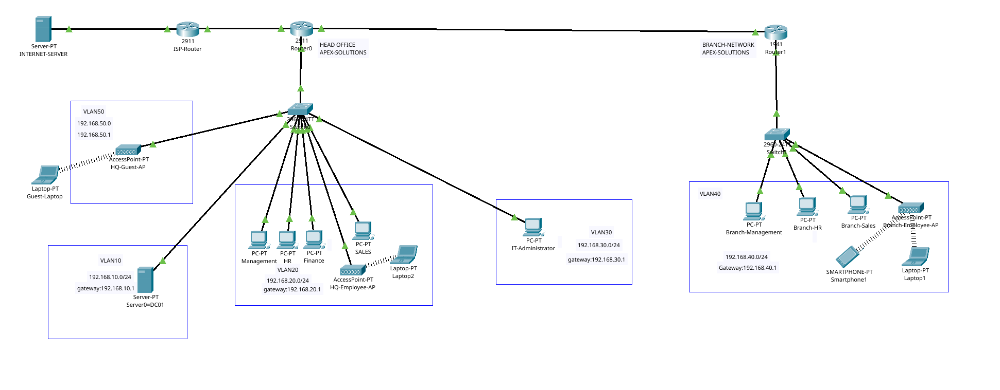

# Apex Solutions — Multi-Site Enterprise Network

> **One end-to-end Cisco Packet Tracer lab** covering network design, implementation, segmentation, connectivity, wireless access, simulated Internet access, security, and troubleshooting.

## 1. Project overview

This project models a small organization, **Apex Solutions**, with a headquarters (HQ), a branch office, internal services, employee and IT networks, wireless access, and a simulated external Internet web server. The topology evolved during one continuous lab: we began with a basic switched LAN, added a second routed site, introduced VLANs and centralized DHCP, and finished with NAT/PAT and access-control policies.

**Platform:** Cisco Packet Tracer  
**Project scope:** One integrated lab (not separate numbered labs)  
**Status:** Completed and connectivity/security tested in Packet Tracer.

### Learning objectives

- Identify the roles of routers, Layer 2 switches, servers, access points, endpoints, and Ethernet links.
- Configure router-on-a-stick, VLAN access ports and 802.1Q trunks.
- Connect HQ and branch networks with static routing.
- Provide addressing through centralized DHCP and DHCP relay, plus router-hosted guest DHCP.
- Resolve internal hostnames through DNS and test HTTP services.
- Configure default routing and NAT overload (PAT) for a simulated Internet.
- Restrict user/branch access to the IT VLAN and isolate Guest Wi-Fi using extended ACLs.
- Verify configurations and troubleshoot physical, Layer 2, Layer 3 and policy failures.

## 2. Final topology




```text
                              INTERNET-SERVER
                              Gi0 203.0.13.1/30
                                      |
                               ISP Router (2911)
                        Gi0/1 203.0.13.2/30
                        Gi0/0 203.0.13.6/30
                                      |
                          203.0.13.4/30 Ethernet
                                      |
                        HQ Router0 (Cisco 2911)
                        Gi0/2 203.0.13.5/30
                         /                  \
           Gi0/0 802.1Q trunk          Gi0/1 10.0.0.1
                    |                       |
              HQ Switch0              Branch Router1
          /       |       \             10.0.0.2
       VLAN10   VLAN20   VLAN30              |
       Servers  Users    IT Admin       Branch Switch1
          |       |                        VLAN40
      DC01       HQ employee AP           Branch AP
    .10 server   + wired PCs              + wired PCs
                    |
            VLAN50 Guest AP
            + Guest Laptop
```

The diagram is conceptual: Guest VLAN 50 is also connected to HQ Switch0, and its gateway is the `Gi0/0.50` subinterface on Router0. The existing branch link is configured as `10.0.0.0/24` in the observed final Router0 routing table; the project does **not** require changing that working link to /30.

### Devices and roles

| Device | Role |
|---|---|
| HQ Router0 — Cisco 2911 | Inter-VLAN gateway, HQ–branch routing, default route, NAT/PAT and HQ ACLs |
| Branch Router1 — Cisco 1941 | Branch VLAN 40 gateway, DHCP relay, branch ACL and default route toward HQ |
| ISP Router — Cisco 2911 | Simulated upstream network connecting HQ to the external web server |
| Switch0 / Switch1 — Cisco 2960 | VLAN access ports and 802.1Q router-facing trunks |
| Internal Server / DC01 (Packet Tracer Server-PT) | Simulated centralized DHCP, DNS and internal web services; **not an actual Windows AD DS installation** |
| INTERNET-SERVER | External HTTP endpoint for Internet/NAT testing |
| HQ employee AP, branch employee AP | Wireless access bridged into the relevant employee VLANs |
| HQ guest AP | Dedicated guest SSID connected to VLAN 50 |
| PCs, laptops and smartphone | Wired and wireless test clients |

## 3. Addressing and VLAN plan

| Network | Purpose | Subnet | Gateway / interface |
|---|---|---|---|
| VLAN 10 | HQ Servers | `192.168.10.0/24` | Router0 `Gi0/0.10` — `192.168.10.1` |
| VLAN 20 | HQ Employees (Management, HR, Finance, Sales) | `192.168.20.0/24` | Router0 `Gi0/0.20` — `192.168.20.1` |
| VLAN 30 | IT Administration | `192.168.30.0/24` | Router0 `Gi0/0.30` — `192.168.30.1` |
| VLAN 40 | Branch Employees | `192.168.40.0/24` | Router1 `Gi0/0.40` — `192.168.40.1` |
| VLAN 50 | HQ Guest Wi-Fi | `192.168.50.0/24` | Router0 `Gi0/0.50` — `192.168.50.1` |
| HQ–Branch transit | Inter-site Ethernet | `10.0.0.0/24` (observed) | Router0 `Gi0/1` — `10.0.0.1`; Router1 — `10.0.0.2` |
| HQ–ISP transit | WAN Ethernet | `203.0.13.4/30` | Router0 `Gi0/2` — `203.0.13.5`; ISP `Gi0/0` — `203.0.13.6` |
| ISP–Internet server | External Ethernet | `203.0.13.0/30` | ISP `Gi0/1` — `203.0.13.2`; Server `GigabitEthernet0` — `203.0.13.1` |

**Key hosts:** Internal Server/DC01 `192.168.10.10` (static); Internet Server `203.0.13.1/30`, default gateway `203.0.13.2`. Endpoint DHCP leases vary: check `ipconfig` rather than assuming `.101` belongs to a particular PC. `203.0.13.x` is used only inside this Packet Tracer simulation; it is not a claim of a real public allocation.

## 4. Implementation journey

### Phase A — Basic office LAN

Connected three PCs and one server to an HQ 2960 switch, then connected the switch to a router. Assigned static `192.168.10.0/24` addresses, verified same-LAN communication, configured the server DHCP pool and moved clients to DHCP. Configured an internal DNS A record, `dc01.apex.local → 192.168.10.10`, and verified name resolution and web access.

### Phase B — Branch and static routing

Built a second switched LAN and connected Router0 to Router1 using the `10.0.0.x` transit network. Added static routes in both directions and verified branch-to-HQ ping and HTTP connectivity. Later introduced a branch router-on-a-stick subinterface for VLAN 40.

### Phase C — VLAN segmentation and centralized services

Configured HQ VLANs 10 (Servers), 20 (Employees) and 30 (IT), plus branch VLAN 40. Assigned switch access ports, configured 802.1Q trunks and router subinterfaces, and used `ip helper-address 192.168.10.10` on routed employee/branch VLAN interfaces to forward DHCP to the centralized server. Created corresponding DHCP scopes and tested actual leases.

### Phase D — Department security ACLs

Configured `USERS-IN` inbound on Router0 `Gi0/0.20` and `BRANCH-IN` inbound on Router1 `Gi0/0.40`. These deny employee/branch-initiated traffic to IT VLAN 30 while permitting other required traffic. Explicit ICMP `echo-reply` exceptions permit replies to IT-initiated pings; basic router ACLs are stateless, unlike a stateful firewall.

### Phase E — Simulated Internet and NAT/PAT

Replaced the original HQ 1941 with a Cisco 2911 to obtain a third GigabitEthernet interface while preserving the existing HQ switch and branch connections. Connected `Gi0/2` to ISP Router `Gi0/0`; ISP `Gi0/1` connects via straight-through Ethernet to the Internet Server's `GigabitEthernet0`. Added Router0's default route to `203.0.13.6`, the branch default route toward `10.0.0.1`, and PAT on Router0 using outside interface `Gi0/2`. Included VLANs 10, 20, 30, 40 and 50 in `APEX-NAT`, with the branch-facing `Gi0/1` marked NAT inside.

### Phase F — Employee wireless

Connected HQ employee AP to an access port in VLAN 20 and branch employee AP to VLAN 40. Associated wireless laptops/smartphone, obtained DHCP leases and tested internal and simulated external reachability.

### Phase G — Guest Wi-Fi isolation

Created HQ VLAN 50 and a separate `HQ-Guest-AP`, connected to Switch0 `Fa0/11`. Added Router0 `Gi0/0.50` (`192.168.50.1/24`), a local `APEX-GUEST` DHCP pool and VLAN 50 to PAT. Applied `GUEST-IN` inbound to allow DHCP and the simulated Internet Server while denying routed access to company VLANs and transit infrastructure. This is routed guest isolation; wireless client-to-client isolation and a stateful firewall are separate production controls.

## 5. Security policy and validation

| Source | Destination | Expected result |
|---|---|---|
| HQ employees (VLAN 20) | Internal server (VLAN 10) | Allowed |
| HQ employees (VLAN 20) | IT (VLAN 30) | Denied |
| Branch (VLAN 40) | Internal server (VLAN 10) | Allowed |
| Branch (VLAN 40) | IT (VLAN 30) | Denied |
| IT (VLAN 30) | HQ/branch users | Allowed, including ICMP echo replies |
| HQ/branch employee clients | Internet Server `203.0.13.1` | Allowed through PAT |
| Guest (VLAN 50) | Gateway `192.168.50.1` and Internet Server | Allowed |
| Guest (VLAN 50) | Internal VLANs 10/20/30/40 and transit networks | Denied by guest policy |

**Verification evidence to capture:** `show ip interface brief`, `show ip route`, `show vlan brief`, `show interfaces trunk`, `show access-lists`, `show ip nat translations`, `show ip dhcp binding`, client `ipconfig`, successful HTTP browser page, and representative successful/failed pings. Confirm the actual addresses and ACL match counters on the saved final topology.

## 6. Troubleshooting log

| Symptom | Root cause / lesson | Resolution |
|---|---|---|
| Guest laptop associated with AP but could not get DHCP or ping `192.168.50.1`, even with a correct static address | Guest AP cable was plugged into Switch0 `Fa0/8`, while VLAN 50 was configured on `Fa0/11` | Moved cable to the configured `Fa0/11`; connectivity restored |
| HQ employees could ping IT despite intended policy | `USERS-IN` ACL was missing from Router0 after network reconfiguration | Restored the ACL and its inbound attachment on `Gi0/0.20`; restriction verified |
| IT-initiated pings to employee/branch PCs initially failed | Stateless inbound ACLs also blocked ICMP replies | Added narrow `echo-reply` permits before the deny entries |
| Apparent branch PC connectivity failure | Ping targeted an assumed `.101`, but DHCP had assigned a different address | Checked actual `ipconfig` / DHCP lease and tested the correct IP |
| Router output paused at `--More--` | Cisco CLI output pagination, not a configuration error | Used Space/Enter to continue reading |

**Troubleshooting principle:** verify cable and physical port → switch VLAN/access port → trunk → router subinterface/gateway → DHCP/IP configuration → routing → ACL → NAT → application. Avoid changing a working layer while diagnosing a different one.

## 7. Screenshot organization


```text
Analyzing-Real-Infrastructure-Using-Packet-Tracer/Lab-01/
├── README.md
├── CommandsCheatSheet.md
├── Apex-Solutions-Enterprise-Network-Final.pkt
└── Screenshots/
    ├── Final-Topology.png
    ├── HQ-VLANs-and-Trunk.png
    ├── HQ-Router-Interfaces-and-Routes.png
    ├── Branch-VLAN-and-Routes.png


## 8. Lessons and limitations

This lab demonstrates how a network supports server services: Ethernet links and switching provide local access, VLANs define broadcast domains, router subinterfaces provide gateways, routing joins sites, DHCP/DNS support clients, NAT provides translated external access, and ACLs enforce basic packet-filtering policy. Packet Tracer's Server-PT **simulates** network services; it does not run the real Windows Server AD DS/GPO/NTFS stack from the separate VirtualBox labs. This is an educational simulation, not a production security certification.

**Outcome:** A completed, tested multi-site Packet Tracer network with HQ, branch, employee and guest wireless, simulated Internet, centralized internal services and documented troubleshooting.
